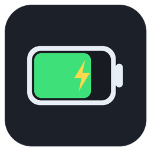

# 蓝牙电量桌面显示 · BLPowerBattery

一个面向 Windows 的轻量桌面小组件，用于显示已连接蓝牙设备上报给系统的电量。

当前稳定版本：**1.0.0**（首个正式 Release）



## 功能

- 透明、无边框桌面小组件
- 通过 Windows SetupAPI 快速读取蓝牙设备电量
- PowerShell 兼容回退
- 可配置窗口大小、透明度、字体颜色和刷新间隔
- 低电量托盘提醒
- 单实例运行及开机启动
- 支持打包为单文件 EXE

> 设备必须向 Windows 上报 `DEVPKEY_Device_BatteryLevel` 属性。是否可读取取决于设备及其驱动。

## 快速开始

安装依赖：

```powershell
python -m pip install -r requirements.txt
```

运行源码：

```powershell
$env:PYTHONPATH = "$PWD\src"
python -m blpower
```

也可以双击 `scripts/run.bat`，以无控制台窗口方式运行。

## 操作

| 操作 | 功能 |
| --- | --- |
| 左键拖动 | 移动窗口并记忆位置 |
| 双击 | 立即刷新电量 |
| 右键 | 打开设置菜单 |
| 托盘图标单击 | 显示或隐藏 |
| 关闭窗口 | 隐藏到托盘；托盘关闭时退出 |

## 项目结构

```text
blpower/
├── assets/
│   ├── app.ico                 # 应用图标
│   └── app_preview.png         # 图标预览
├── docs/
│   ├── architecture.md         # 架构与模块职责
│   ├── changelog.md            # Release 版本记录
│   └── development.md          # 开发、测试与发布说明
├── scripts/
│   ├── build.bat               # Windows 打包入口
│   ├── generate_icon.py        # 图标生成脚本
│   ├── run.bat                 # Windows 无控制台启动入口
│   └── windows_version_info.txt # Windows EXE 版本资源
├── src/
│   └── blpower/
│       ├── __init__.py
│       ├── __main__.py         # `python -m blpower` 入口
│       ├── app.py              # 主程序及 Windows 集成
│       ├── display.py          # 颜色与设备图标等纯函数
│       └── version.py          # 应用版本号
├── tests/
│   └── test_helpers.py         # 基础单元测试
├── blpower_battery.spec        # PyInstaller 配置
├── requirements.txt            # 运行依赖
├── README.md
└── LICENSE
```

## 测试与打包

运行测试：

```powershell
$env:PYTHONPATH = "$PWD\src"
python -m unittest discover -s tests -v
```

生成 EXE：

```powershell
python -m pip install pyinstaller
python -m PyInstaller --noconfirm blpower_battery.spec
```

或者双击 `scripts/build.bat`。输出位于 `dist/BLPowerBattery.exe`。

更多内容见 [架构说明](docs/architecture.md)、[开发与发布](docs/development.md)和[版本记录](docs/changelog.md)。

## License

MIT
